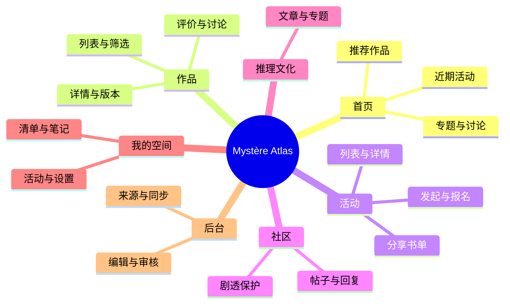

# MVP 与开发路线

## 产品目标

发现作品 → 个人清单 → 体验 → 评价与讨论。

发现活动 → 报名参加 → 分享作品 → 留下共同书单 → 继续交流。

## MVP 范围

- 中英法界面、作品多语言名称与别名。
- 小说、电影、剧集优先；数据设计为游戏、剧本杀和密室预留扩展。
- 邮箱注册、登录、验证、密码管理、用户资料。
- 清单、体验状态、评分、私人笔记、基础公开清单。
- 社区帖子、回复、作品或活动关联、剧透标记、举报。
- 用户发起免费活动、管理员审核、报名与取消、活动书单。
- 外部活动明确来源并跳转原站报名；站内收藏不等于外部报名成功。
- 编辑发布文化文章、名家与经典专题。
- 至少一个作品来源和一个活动来源试点，提供审核与同步管理。
- 维护作品、文章、活动、举报与候选资料的后台。

## 页面结构

## 里程碑

1. 环境与技术骨架：本地运行、三语入口、VS Code 断点、GitHub CI。
2. 产品与数据确认：首批用户地区、试点城市、来源验证、旧版导出清单。
3. 账号与权限：邮箱认证、资料、私人记录隔离、后台身份。
4. 作品与个人记录：列表、详情、搜索、版本、清单、评分、笔记。
5. 活动：发起、审核、报名、容量与取消、通知、共同书单。
6. 社区与文化：帖子、回复、剧透、举报、专题编辑。
7. 自动更新：来源适配、去重、审核、重试、更新记录。
8. 迁移与试运营：三语和移动端验证、地区访问检查、备份恢复、真实分享会验收。

本次只完成第 1 项，其余项目尚未实施。来源可行性应在后续开发初期验证。

## 验收场景

一次真实读书分享会：参与者发现活动并报名，分享作品，收藏同好的推荐，在活动结束后继续讨论。管理者可以维护活动及资料，作品和外部活动来源按计划更新。

## 待确定

首批用户地区、活动试点城市、首批数据来源、旧版数据可导出范围。账号凭据迁移需要单独核验，不保证旧密码可继续使用。
